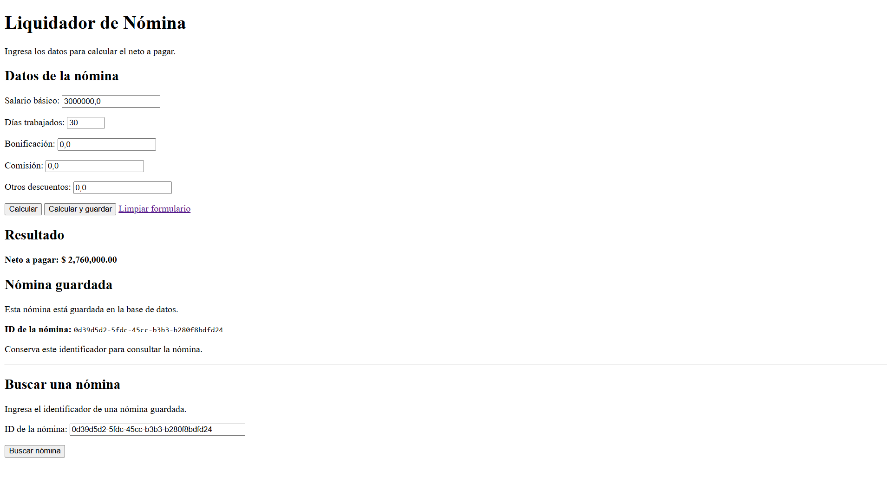
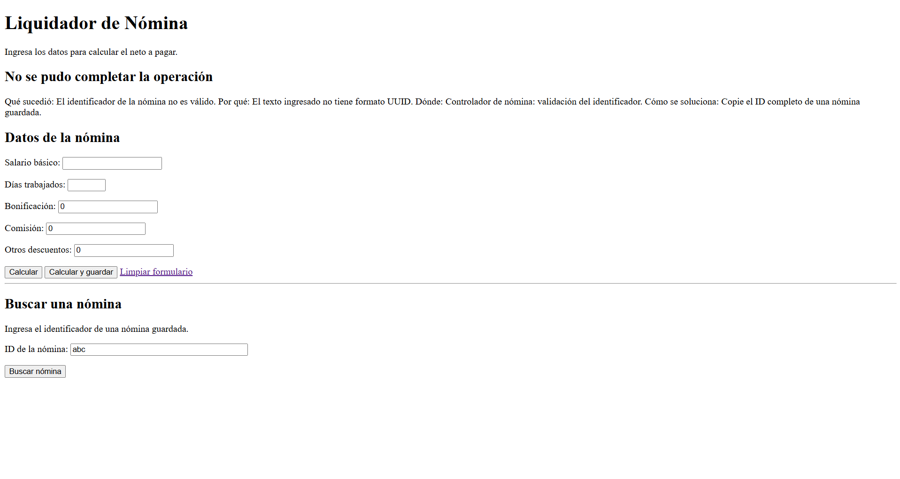
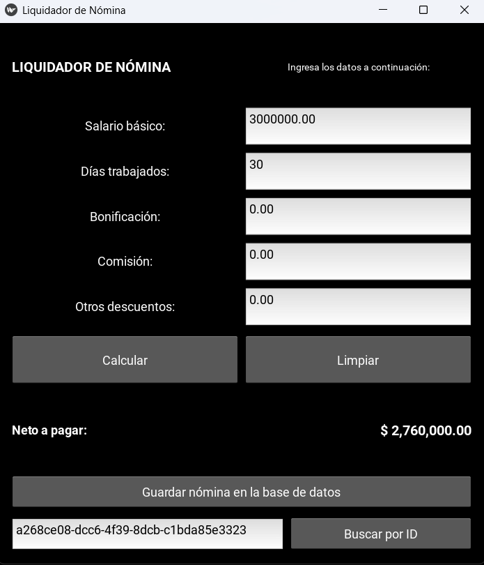
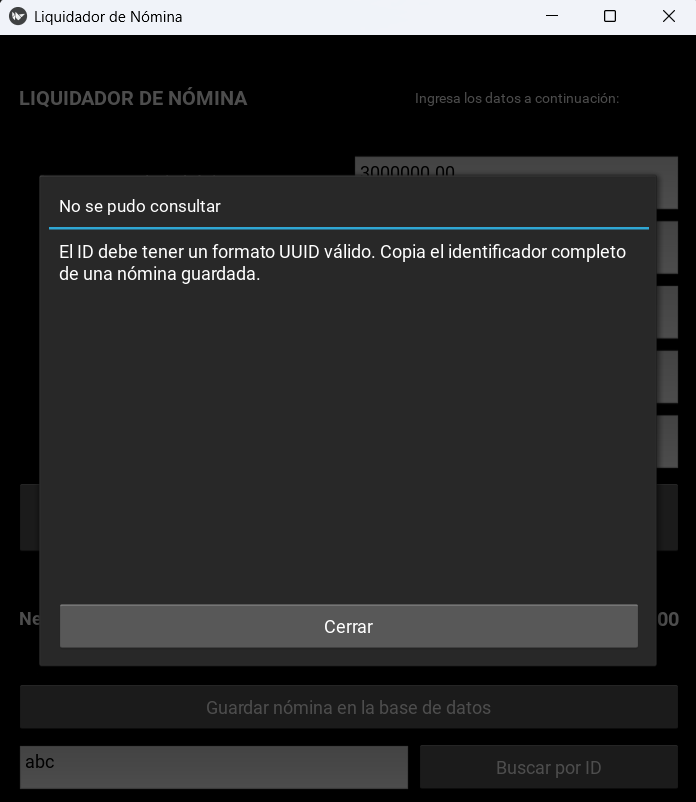

# Liquidador de Nómina

## Integrantes

- Yeisner Giraldo
- Samuel Garcia
- Sebastian Leal
- David Rios

## Aplicación publicada y repositorio

- Aplicación web: https://liquidador-nomina-web.onrender.com/
- Repositorio: https://github.com/David-Giraldo01/Liquidador-Nomina
- Rama de la entrega web: `entrega-5-web`.

## Descripción

Aplicación desarrollada en Python para calcular el neto a pagar de una nómina a partir del salario básico, los días trabajados, las bonificaciones, las comisiones y otros descuentos.

La entrega 5 permite acceder desde el navegador a la funcionalidad de cálculo y persistencia de la entrega anterior.

La aplicación web permite:

- Acceder a las funcionalidades desde un menú de inicio.
- Calcular el neto a pagar.
- Validar los datos ingresados.
- Guardar nóminas en PostgreSQL.
- Buscar nóminas mediante su identificador UUID.
- Crear la tabla necesaria desde una opción del menú.
- Mostrar mensajes de validación y errores de la aplicación.

El proyecto también conserva las interfaces de escritorio con Kivy y de consola de las entregas anteriores.

## Tecnologías

- Python.
- Flask y Blueprints.
- HTML y plantillas Jinja.
- PostgreSQL.
- `psycopg2-binary`.
- `unittest`.
- Gunicorn para ejecutar la aplicación publicada.
- Render para alojar la aplicación y PostgreSQL.
- Kivy para la interfaz de escritorio.

## Arquitectura MVC y Blueprints

El proyecto separa sus responsabilidades siguiendo el patrón Modelo–Vista–Controlador.

| Componente | Ubicación | Responsabilidad |
|---|---|---|
| Modelo | `src/model/` | Representar los datos, validar las reglas de negocio y calcular la nómina. |
| Controlador | `src/controller/` | Conectar con PostgreSQL e insertar, buscar, crear y eliminar tablas. |
| Vista web | `src/view/web/` | Recibir solicitudes HTTP, utilizar el modelo y el controlador y preparar las respuestas. |
| Plantillas | `templates/` | Presentar el menú, los formularios, los resultados y los mensajes. |
| Inicio de Flask | `app.py` | Crear la aplicación y registrar el Blueprint. |

El archivo `src/view/web/vista_nomina.py` define el Blueprint `nomina`.

En `app.py`, la función `crear_aplicacion()` crea la instancia de Flask y registra el Blueprint mediante `register_blueprint()`.

La lógica del cálculo y las operaciones SQL se reutilizan desde sus módulos correspondientes.

### Flujo de una operación

1. El usuario envía un formulario desde el navegador.
2. Una ruta del Blueprint recibe los datos.
3. El modelo valida y calcula la nómina.
4. Cuando corresponde guardar o buscar, se utiliza `NominaController`.
5. La vista renderiza una plantilla con el resultado o el mensaje de error.

## Organización del proyecto

| Ruta | Responsabilidad |
|---|---|
| `app.py` | Punto de entrada de la aplicación web y registro del Blueprint. |
| `main.py` | Punto de entrada de la interfaz de escritorio. |
| `src/model/datos_nomina.py` | Clase `DatosNomina` e identificador UUID. |
| `src/model/constantes.py` | Constantes utilizadas en el cálculo. |
| `src/model/errores.py` | Excepciones propias de la aplicación. |
| `src/model/validacion.py` | Validaciones de negocio. |
| `src/model/logica_nomina.py` | Cálculo de la nómina. |
| `src/controller/nomina_controller.py` | Conexión y operaciones con PostgreSQL. |
| `src/controller/entorno_pruebas.py` | Preparación y limpieza del entorno de pruebas de base de datos. |
| `src/view/web/__init__.py` | Paquete de la interfaz web. |
| `src/view/web/vista_nomina.py` | Blueprint y rutas web. |
| `src/view/Gui/liquidador.py` | Interfaz de escritorio con Kivy. |
| `src/view/console/consola.py` | Interfaz de consola. |
| `templates/base.html` | Estructura común y menú de navegación. |
| `templates/inicio.html` | Menú de inicio. |
| `templates/nomina.html` | Formulario, resultado y búsqueda de nóminas. |
| `templates/crear_tablas.html` | Creación de la tabla desde la web. |
| `sql/crear_tablas.sql` | Definición de la tabla `nominas`. |
| `tests/tests_nomina.py` | Pruebas de la lógica de negocio. |
| `tests/test_nomina_controller.py` | Pruebas del controlador de base de datos. |
| `secret_config_sample.py` | Plantilla de conexión sin credenciales privadas. |
| `secret_config.py` | Configuración privada, excluida de Git. |
| `requirements-web.txt` | Dependencias necesarias para la aplicación web. |
| `requirements.txt` | Dependencias que incluyen la interfaz de escritorio. |
| `migrar_uuid.py` | Script de migración de la versión anterior con ID entero. |
| `docs/` | Evidencias y documentación. |

## Entradas y resultado

| Campo | Descripción |
|---|---|
| Salario básico | Salario mensual del empleado. |
| Días trabajados | Número entero entre 0 y 30. |
| Bonificación | Valor de las bonificaciones. |
| Comisión | Valor de las comisiones. |
| Otros descuentos | Descuentos adicionales. |

Los importes deben ser números finitos y no negativos.

El cálculo utiliza el salario proporcional a los días trabajados, incorpora bonificaciones y comisiones, calcula las deducciones de salud y pensión y aplica los otros descuentos.

La interfaz muestra el neto con formato monetario. Al guardar, también permite obtener el UUID para consultar el registro posteriormente.

## Requisitos para ejecutar localmente

- Python instalado. La ejecución local fue comprobada con Python 3.13.
- Git, si se obtiene el proyecto mediante clonación.
- PostgreSQL local o remoto.
- Una base de datos existente y credenciales válidas.
- Un navegador web.
- Conexión a Internet para instalar dependencias y acceder a una base de datos remota.

Las instrucciones siguientes corresponden a Windows y PowerShell.

## 1. Obtener el proyecto

Clonar directamente la rama de la entrega web:

```powershell
git clone --branch entrega-5-web https://github.com/David-Giraldo01/Liquidador-Nomina.git
cd Liquidador-Nomina
```

Todos los comandos siguientes se ejecutan desde esta carpeta, donde se encuentra `app.py`.

## 2. Crear el entorno virtual

```powershell
py -m venv .venv
```

Los comandos utilizan directamente el intérprete del entorno virtual, por lo que no es necesario activarlo.

## 3. Instalar las dependencias web

```powershell
.\.venv\Scripts\python.exe -m pip install -r requirements-web.txt
```

El archivo `requirements-web.txt` contiene:

```text
Flask==3.1.3
psycopg2-binary
gunicorn; sys_platform != "win32"
```

Kivy no es necesario para ejecutar la aplicación web.

Gunicorn se instala en sistemas distintos de Windows. Para la ejecución local en Windows se utiliza `app.py`.

## 4. Preparar una base de datos en blanco

La aplicación crea la tabla de nóminas, pero la base de datos debe existir previamente.

### Opción A: PostgreSQL local

1. Instalar PostgreSQL y conservar las credenciales del usuario.
2. Abrir pgAdmin y conectarse al servidor.
3. Abrir una ventana de consultas sobre una base existente, por ejemplo `postgres`.
4. Ejecutar por separado y fuera de una transacción explícita:

```sql
CREATE DATABASE nomina_db;
```

El usuario debe tener permiso para crear bases de datos.

La nueva base `nomina_db` puede permanecer sin tablas: estas se crean desde el menú de la aplicación.

### Opción B: PostgreSQL remoto

1. Crear una instancia PostgreSQL en el proveedor.
2. Obtener el host, puerto, nombre de base de datos, usuario y contraseña.
3. Verificar que permita conexiones desde el equipo.
4. Utilizar estos datos en `secret_config.py`.

Para conectarse desde el computador a Render, se utiliza el host externo.

Si el proveedor ya creó la base de datos, no se necesita ejecutar `CREATE DATABASE`.

## 5. Configurar la conexión

Si todavía no existe `secret_config.py`, copiar la plantilla:

```powershell
Copy-Item secret_config_sample.py secret_config.py
```

No sobrescribir una configuración existente que se quiera conservar.

Editar el archivo `secret_config.py`, ubicado junto a `app.py`, con los datos de la base:

```python
HOST = "localhost"
PORT = 5432
DATABASE = "nomina_db"
USER = "tu_usuario"
PASSWORD = "tu_contrasena"
SSLMODE = "prefer"
```

Para un servidor remoto que requiera SSL:

```python
SSLMODE = "require"
```

También se deben reemplazar el host, la base, el usuario y la contraseña por los datos del proveedor.

Cada asignación debe estar en su propia línea.

### Protección de credenciales

`secret_config.py` es privado y debe permanecer excluido de Git.

Comprobar que está ignorado:

```powershell
git check-ignore -v secret_config.py
```

Comprobar que no está siendo rastreado:

```powershell
git ls-files secret_config.py
```

El segundo comando no debe mostrar ninguna ruta.

El archivo `secret_config_sample.py` debe contener únicamente valores de ejemplo.

### Comprobar la conexión

```powershell
.\.venv\Scripts\python.exe -c "from src.controller.nomina_controller import NominaController; c = NominaController.conectar(); c.close(); print('Conexion correcta')"
```

Resultado esperado:

```text
Conexion correcta
```

## 6. Ejecutar la aplicación web localmente

```powershell
.\.venv\Scripts\python.exe app.py
```

Mantener abierta la terminal y visitar:

http://127.0.0.1:5000/

La página inicial muestra las opciones:

- Calcular y guardar.
- Buscar nómina.
- Crear tablas.

Para detener el servidor local, presionar `Ctrl+C` en la terminal.

## 7. Crear las tablas desde la aplicación

Para comenzar con una base de datos en blanco:

1. Configurar la conexión a esa base.
2. Ejecutar `app.py`.
3. Abrir http://127.0.0.1:5000/
4. Seleccionar **Crear tablas** en el menú.
5. Presionar el botón **Crear tablas**.
6. Comprobar el mensaje de creación.
7. Ir al formulario para guardar una nómina.

La operación utiliza `NominaController.crear_tablas()`, que lee `sql/crear_tablas.sql`.

Si la tabla ya existe, la interfaz informa esta situación y conserva los registros existentes. No es necesario crearla cada vez que se inicia la aplicación.

Esta opción crea la tabla dentro de la base configurada; no crea una nueva instancia PostgreSQL.

## Uso de la aplicación web

### Calcular

1. Entrar en **Calcular y guardar**.
2. Completar los cinco campos.
3. Presionar **Calcular**.
4. Consultar el neto a pagar.

La opción **Calcular** no guarda un registro en PostgreSQL.

### Insertar una nómina

1. Completar los campos.
2. Presionar **Calcular y guardar**.
3. La aplicación valida los datos, calcula el resultado e inserta la nómina.
4. Se redirige a la consulta del registro guardado.
5. Copiar el UUID mostrado.

Después de guardar se realiza una redirección HTTP 303 para evitar repetir la inserción al actualizar la página de resultado.

### Buscar una nómina

1. Seleccionar **Buscar nómina**.
2. Pegar el UUID completo de una nómina guardada.
3. Presionar **Buscar nómina**.
4. Comprobar los datos recuperados y el resultado.

Si el formato es incorrecto o no existe el registro, se muestra un mensaje de error.

### Limpiar el formulario

La opción **Limpiar formulario** permite iniciar un nuevo cálculo.

Limpiar el formulario no elimina los registros de PostgreSQL.

## Ejemplo de funcionamiento

| Campo | Valor |
|---|---:|
| Salario básico | 3000000 |
| Días trabajados | 30 |
| Bonificación | 0 |
| Comisión | 0 |
| Otros descuentos | 0 |

Resultado esperado:

```text
Neto a pagar: $ 2,760,000.00
```

Para comprobar la persistencia:

1. Guardar la nómina.
2. Copiar su UUID.
3. Volver al menú de inicio.
4. Entrar en la búsqueda.
5. Consultar el UUID.
6. Comprobar que se recuperan los mismos datos y resultado.

Para comprobar un caso de error, buscar el identificador `abc`. La aplicación debe informar que el identificador no tiene formato UUID válido.

## Rutas web

| Ruta | Método | Función |
|---|---|---|
| `/` | GET | Mostrar el menú de inicio. |
| `/calcular` | GET | Mostrar el formulario. |
| `/calcular` | POST | Calcular sin guardar. |
| `/guardar` | POST | Validar e insertar una nómina. |
| `/buscar` | GET | Mostrar la búsqueda o procesar el UUID ingresado. |
| `/nomina/<id_nomina>` | GET | Consultar y mostrar una nómina guardada. |
| `/crear-tablas` | GET | Mostrar la pantalla de creación. |
| `/crear-tablas` | POST | Solicitar la creación de la tabla. |

## Persistencia y controlador

La clase `DatosNomina` representa los datos de una nómina.

Los objetos nuevos reciben un identificador generado en Python mediante `str(uuid4())`. PostgreSQL lo almacena en una columna de tipo `UUID`.

El controlador realiza la correspondencia entre los objetos de Python y las filas de PostgreSQL utilizando `psycopg2`.

| Método | Responsabilidad |
|---|---|
| `conectar()` | Abrir una conexión utilizando la configuración privada. |
| `validar_id(id_nomina)` | Verificar y normalizar el UUID. |
| `insertar(nomina)` | Guardar los datos y devolver el identificador. |
| `buscar(id_nomina)` | Recuperar los datos y reconstruir un objeto `DatosNomina`. |
| `crear_tablas()` | Ejecutar el archivo SQL de creación. |
| `borrar_tablas()` | Eliminar la tabla de nóminas. |

Las consultas utilizan parámetros para enviar los valores por separado del SQL.

Las operaciones confirman los cambios con `commit()`, revierten los errores de base de datos con `rollback()` y cierran sus recursos al terminar.

La eliminación de tablas se conserva en el controlador para las operaciones correspondientes y las pruebas. No se ofrece como opción del menú web.

## Manejo de errores

La aplicación utiliza excepciones propias basadas en `ErrorNomina`.

Los mensajes incluyen:

- Qué sucedió.
- Por qué ocurrió.
- Dónde ocurrió.
- Cómo solucionarlo.

Se contemplan errores de validación, identificadores inválidos, nóminas inexistentes, duplicados, tablas y conexión con PostgreSQL.

En la creación web, el error de tabla existente se transforma en un mensaje que permite continuar usando la aplicación.

## Pruebas automatizadas

El proyecto conserva 22 pruebas automatizadas:

- 10 pruebas de la lógica de negocio.
- 12 pruebas del controlador y su integración con PostgreSQL.

Las pruebas del controlador requieren una conexión válida y un usuario con permiso para crear esquemas en la base configurada.

### Fixtures y aislamiento

Cada prueba del controlador:

1. Prepara un esquema con un nombre único.
2. Configura las conexiones para utilizar ese esquema.
3. Crea la tabla mediante el controlador.
4. Ejecuta el caso de prueba.
5. Limpia el esquema al finalizar.

La preparación y limpieza del entorno se apoyan en `src/controller/entorno_pruebas.py`.

El aislamiento evita que las operaciones de creación y eliminación de las pruebas se realicen sobre la tabla principal de nóminas.

### Casos del controlador

- Insertar y buscar una nómina válida.
- Conservar el UUID generado en Python.
- Insertar valores con centavos.
- Buscar el registro correcto entre varias nóminas.
- Rechazar salarios negativos.
- Rechazar días fuera de rango.
- Rechazar un UUID duplicado y conservar el original.
- Informar una nómina inexistente.
- Rechazar un identificador con formato inválido.
- Crear tablas y comprobar que permiten guardar y consultar.
- Manejar la creación de una tabla existente.
- Comprobar la eliminación de tablas y el error cuando no existen.

Algunas comprobaciones se realizan dentro del mismo método de prueba.

### Ejecutar todas las pruebas

Desde la raíz, después de instalar las dependencias y configurar la conexión:

```powershell
.\.venv\Scripts\python.exe -m unittest tests.tests_nomina tests.test_nomina_controller -v
```

Resultado obtenido en la ejecución local posterior a la incorporación de la interfaz web:

```text
Ran 22 tests in 132.640s

OK
```

El tiempo depende del equipo y la conexión.

### Ejecutar únicamente las pruebas de lógica

```powershell
.\.venv\Scripts\python.exe -m unittest tests.tests_nomina -v
```

### Ejecutar únicamente las pruebas del controlador

```powershell
.\.venv\Scripts\python.exe -m unittest tests.test_nomina_controller -v
```

Estas pruebas automatizadas se complementan con la comprobación manual de los formularios web.

## Publicación en Render

La aplicación publicada utiliza los siguientes parámetros:

| Parámetro | Valor |
|---|---|
| Tipo de servicio | Web Service |
| Lenguaje | Python 3 |
| Rama | `entrega-5-web` |
| Root Directory | Vacío; se utiliza la raíz del repositorio. |
| Build Command | `pip install -r requirements-web.txt` |
| Start Command | `gunicorn app:app` |
| Health Check Path | `/` |

La expresión `app:app` indica el módulo `app.py` y la instancia de Flask llamada `app`.

### Configuración privada en el servidor

En la configuración de archivos secretos del servicio se añade:

```text
secret_config.py
```

Su contenido debe incluir las seis asignaciones de conexión a PostgreSQL, cada una en una línea:

- `HOST`
- `PORT`
- `DATABASE`
- `USER`
- `PASSWORD`
- `SSLMODE`

Este archivo se configura en el servidor y no se publica en GitHub.

La aplicación desplegada necesita una base PostgreSQL disponible. Si se configura una base vacía, se utiliza la opción **Crear tablas** antes de insertar registros.

### Dependencias web y de escritorio

Render instala `requirements-web.txt`, que contiene las dependencias necesarias para Flask y PostgreSQL.

El archivo `requirements.txt` conserva las dependencias de escritorio, incluida Kivy. Esta separación evita instalar Kivy al publicar la aplicación web.

## Interfaces de entregas anteriores

### Escritorio con Kivy

Instalar las dependencias completas:

```powershell
.\.venv\Scripts\python.exe -m pip install -r requirements.txt
```

Ejecutar:

```powershell
.\.venv\Scripts\python.exe main.py
```

La interfaz de escritorio permite calcular, guardar y buscar nóminas utilizando el modelo y el controlador del proyecto.

### Consola

```powershell
.\.venv\Scripts\python.exe -m src.view.console.consola
```

La consola permite ingresar los datos y obtener el resultado del cálculo.

### Migración de bases anteriores

El archivo `migrar_uuid.py` se conserva para las bases de versiones anteriores que utilizaban identificadores enteros.

Las instalaciones nuevas utilizan UUID desde la creación de la tabla y no necesitan ejecutar esta migración.

## Evidencias

### Consulta desde la interfaz web



### Error de búsqueda desde la interfaz web



### Evidencias de la interfaz de escritorio





## Solución de problemas

| Problema | Acción |
|---|---|
| No se encuentra `secret_config` | Crear `secret_config.py` en la raíz; en Render, configurarlo como archivo secreto. |
| Error de autenticación | Revisar usuario, contraseña y nombre de la base. |
| No se puede conectar | Revisar host, puerto, SSL, acceso de red y disponibilidad de PostgreSQL. |
| La base de datos remota está suspendida o vencida | Revisar su estado en el proveedor y configurar una instancia disponible. |
| La tabla no existe | Entrar en **Crear tablas** y ejecutar la creación. |
| La tabla ya existe | Continuar usando la aplicación; no es necesario recrearla. |
| UUID inválido | Copiar el identificador completo de una nómina guardada. |
| Nómina inexistente | Verificar el UUID y la base de datos configurada. |
| No se encuentra Flask o psycopg2 | Instalar `requirements-web.txt` con el intérprete del entorno virtual. |
| Las pruebas no pueden crear esquemas | Revisar los permisos del usuario de PostgreSQL. |
| Render intenta compilar Kivy | Comprobar que Build Command utilice `requirements-web.txt`. |
| Error de sintaxis en el archivo secreto | Revisar comillas y saltos de línea de `secret_config.py`. |

## Alcance de la entrega 5

La entrega incorpora una aplicación web con Flask y Blueprints que reutiliza la lógica y la persistencia del proyecto anterior.

Incluye menú de inicio, cálculo, inserción, búsqueda por UUID, creación de tablas desde la web, manejo de errores, instrucciones de ejecución local y publicación en Render.

Las interfaces anteriores y las pruebas automatizadas se conservan en el repositorio.